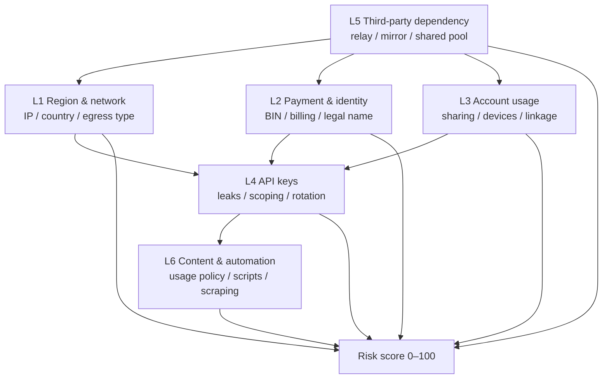

# claude-account-guard

[](LICENSE)
[](https://www.python.org/)
[](#security-model)

[中文](README.md) · **English** — you are reading the English README.

A compliance baseline and incident-response playbook for teams that use Claude and the
Anthropic API, packaged as a **Claude Agent Skill**.

It does three things: audits your repositories for leaked credentials and non-official
endpoints, scores account risk 0–100 across six layers, and gives you evidence-based
appeal templates for when access is already restricted.

> **It is not a ban-evasion tool.** It does not help with residential proxies, IP
> rotation, fingerprint browsers, account trading, fake payment details, or anything
> designed to defeat risk controls. Those things are what get accounts banned — and
> they are also what this project refuses to help with. That refusal is the product.

---

## Contents

- [Why this exists](#why-this-exists)
- [Who it is for](#who-it-is-for)
- [What it does / does not do](#what-it-does--does-not-do)
- [The six-layer model](#the-six-layer-model)
- [Quick start](#quick-start)
- [Risk scorecard](#risk-scorecard)
- [Repository map](#repository-map)
- [Scripts](#scripts)
- [Security model](#security-model)
- [Compliance red lines](#compliance-red-lines)
- [FAQ](#faq)
- [Disclaimer](#disclaimer)
- [Contributing](#contributing)

---

## Why this exists

Most "my Claude account was banned" reports trace back to three avoidable mistakes, not to
mysterious platform behaviour:

1. **Third-party relay APIs.** The relay runs your requests through *its own* upstream
   accounts and its own egress. When the upstream pool is actioned, downstream users go
   with it — and downstream users cannot appeal, because the account was never theirs.
2. **Shared accounts and multi-account juggling.** Same device, same payment method, same
   egress IP, multiple accounts. They are correlated, so they are actioned together.
3. **Leaked API keys.** Committed to a public repo, bundled into a frontend, printed in a
   log, pasted into a screenshot. Public-repo leaks are typically harvested by automation
   within minutes.

All three are *configuration* problems, and all three are removable with zero-cost changes.
This repository turns that into a repeatable review: a knowledge base, a scorecard, four
read-only scripts, and a 72-hour incident playbook.

## Who it is for

- **Teams shipping a product on the Anthropic API** who need a checklist they can paste
  into an internal security review.
- **Engineering leads** inheriting a codebase with an `ANTHROPIC_BASE_URL` pointing at
  something nobody can explain.
- **Anyone who has just lost access** and needs to figure out what to do in the first
  24 hours, with evidence instead of guesswork.
- **Security reviewers** who want a small, auditable, dependency-free scanner they can read
  in one sitting.

If you are looking for a way to use Claude from a region it does not officially serve,
this repository will tell you that the only compliant path is a supported deployment
(cloud provider channel, enterprise agreement, or a different model), and it will not
help you route around the restriction.

## What it does / does not do

| Does | Does not (refused by design) |
| --- | --- |
| Scan repos and git history for leaked credentials | Provide proxies, IP rotation, or fingerprint-browser setup |
| Flag `base_url` / `proxy` configs pointing at non-official hosts | Forge payment details, virtual cards, chargeback tricks |
| Score risk 0–100 across six layers and rank the top three fixes | Bulk registration, account trading/sharing/resale |
| Produce an evidence list and appeal drafts in EN + ZH | Disguise call pacing, spoof User-Agent, ship anti-detection patches |
| Redact a report before you share it | Promise a ban will be reversed, or predict enforcement |
| Explain the *compliant* migration path | Claim that following this repo prevents bans |

## The six-layer model



One layer alone is usually explainable with a bank statement and a calendar. Two
independent layers mean the account's identity story is inconsistent. Layer 5 or 6 means
there is very little left to appeal with — stop the bleeding and migrate.

Each layer is documented with **signal → how it is observed → what you can self-check →
compliant remediation → evidence strength (A/B/C)** in
[`references/ban-causes.md`](references/ban-causes.md) (Chinese).

## Quick start

```bash
git clone https://github.com/Heibuling/claude-account-guard.git
cd claude-account-guard

# 1) read-only audit of your project (no network, no telemetry)
python scripts/audit.py --path ~/projects/my-app --report-dir ~/projects/my-app

# 2) scan git history for leaked keys
python scripts/check_history.py --path ~/projects/my-app

# 3) score risk (fill in the JSON documented in references/risk-scorecard.md)
python scripts/audit.py --scorecard scorecard.json

# 4) redact a report before sharing it
python scripts/redact.py -i report.md -o report.redacted.md
```

Output: terminal summary + `report.md` + `report.json`. Every finding carries a severity,
why it matters, how to fix it, and the relevant official documentation link.

**Install as an Agent Skill** (Claude Code / Claude.ai):

```bash
cp -r claude-account-guard ~/.claude/skills/claude-account-guard   # per-user
cp -r claude-account-guard .claude/skills/claude-account-guard     # per-project
```

The skill activates when a session mentions a suspension, sharing an account or key, a
relay `base_url`, a suspected leak, or an appeal.

### Use as a GitHub Action

The root `action.yml` is a composite action — read-only, no network, no dependencies:

```yaml
name: account-guard
on: [push, pull_request]

jobs:
  guard:
    runs-on: ubuntu-latest
    steps:
      - uses: actions/checkout@v4
        with:
          fetch-depth: 0          # a shallow clone has no history to scan
      - id: guard
        uses: Heibuling/claude-account-guard@v0.2.0
        with:
          path: .
          report-dir: .account-guard
          fail-on: critical       # none / critical / high / medium / info
          check-history: 'true'
          history-fail-on: high
          artifact-name: account-guard-report   # leave empty to skip upload
      - run: echo "critical=${{ steps.guard.outputs.critical }} high=${{ steps.guard.outputs.high }}"
```

Outputs: `steps.guard.outputs.critical` / `.high` / `.report-md` / `.report-json`. The report
directory is excluded from the scan, so re-running on the same workspace is clean.

## When access is already restricted

Evidence normally ends up spread across downloads, chat history and email — and forwarding raw
screenshots is exactly how keys and card numbers leak. `evidence_pack.py` turns the checklist in
`references/incident-response.md` into a directory skeleton:

```bash
python scripts/evidence_pack.py --init --dir ./evidence-pack
python scripts/evidence_pack.py --add 02-payment ~/Downloads/statement.pdf --dir ./evidence-pack
python scripts/evidence_pack.py --list --dir ./evidence-pack
python scripts/evidence_pack.py --build --dir ./evidence-pack
```

You get `dist/MANIFEST.md` (human checklist), `dist/manifest.json` (SHA-256 per file),
`dist/07-timeline/timeline.md` (generated from `timeline.csv`) and a zip.

**Boundary:** text files are redacted automatically; **PDFs and images are not** — the standard
library cannot redact image content, so they are copied as-is and explicitly flagged for manual
review. The pack contains personal data: never commit it.

## Risk scorecard

Six weighted dimensions, 25 binary items, `1` = risk present, `0` = eliminated,
`0.5` = unknown (counted as half — "unknown" is not free).

| Dimension | Weight | Items |
| --- | --- | --- |
| Network consistency | 25 | N1–N5 |
| Payment & identity consistency | 20 | P1–P4 |
| Account usage patterns | 15 | U1–U4 |
| API key hygiene | 15 | K1–K5 |
| Third-party dependency | 15 | T1–T4 |
| Content & automation | 10 | C1–C3 |

Bands: **0–20 low · 21–45 medium · 46–70 high · 71–100 extreme**.

```console
$ python scripts/audit.py --scorecard scorecard.json

claude-account-guard · 风险评分卡

维度                      权重       命中项      得分
网络一致性                25     2.0/5    10.0
支付与身份一致性          20     1.0/4     5.0
账号使用模式              15     2.0/4     7.5
API Key 卫生              15     0.0/5     0.0
第三方依赖                15     0.0/4     0.0
内容与自动化              10     0.0/3     0.0

总分: 22.5/100  → 中风险 (21-45)
建议: 先处理得分最高的两个维度，尤其是支付身份与第三方依赖。

优先补齐:
  1. 网络一致性 的 N1（账号注册地/使用地在服务区域名单内，且接入 IP 属于该地区）
  2. 网络一致性 的 N2（接入 IP 国家与注册地、支付地一致）
  3. 支付与身份一致性 的 P1（卡 BIN 国家 = 账单地址国家 = 接入 IP 国家）
```

The scoring is a heuristic self-check. It has no relationship to any internal risk score.

> The CLI currently prints its human-readable summary in Chinese; an English locale is on
> the roadmap. `report.json` uses English keys throughout, so automation is unaffected.

## Repository map

```
claude-account-guard/
├── SKILL.md                      # Agent Skill entry point (<500 lines, progressive disclosure)
├── action.yml                    # composite GitHub Action (audit + gate + artifact)
├── README.md                     # Chinese README (primary)
├── README.en.md                  # this file
├── LICENSE  CHANGELOG.md  .gitignore  pyproject.toml
├── .github/workflows/ci.yml      # pytest + ruff on 3 OS × 2 Python versions
├── references/                   # knowledge base, loaded on demand (Chinese)
├── scripts/                      # four read-only, stdlib-only scripts
├── assets/scorecard-template.md  # printable 25-item checklist
└── tests/                        # 41 tests + fixtures
```

### Knowledge base

All references are dated with `last-reviewed: YYYY-MM`. **They are written in Chinese** —
English translations are planned; the table below is the index so you can see what is there.

| File | Purpose |
| --- | --- |
| [`ban-causes.md`](references/ban-causes.md) | The six-layer model: signal / observation / self-check / remediation / evidence strength, plus six checklists |
| [`risk-scorecard.md`](references/risk-scorecard.md) | Weights, all 25 pass/fail criteria, bands, worked arithmetic, JSON schema |
| [`network-and-region.md`](references/network-and-region.md) | Region / network / device / timezone consistency, enterprise egress "neighbour" risk |
| [`payment-and-identity.md`](references/payment-and-identity.md) | BIN / billing / IP / legal-name consistency; how to handle a chargeback correctly |
| [`api-key-hygiene.md`](references/api-key-hygiene.md) | Full key lifecycle, mandatory revocation order, `git filter-repo` / BFG cleanup, pre-commit hook |
| [`third-party-risk.md`](references/third-party-risk.md) | Why relay economics guarantees risk; vendor questionnaire, TCO table, migration steps |
| [`incident-response.md`](references/incident-response.md) | 0–24h / 24–72h / 72h+ playbook, evidence list, timeline template, post-mortem |
| [`appeal-templates.md`](references/appeal-templates.md) | Bilingual appeal templates (suspected false positive / shared account / payment) + tone rules |
| [`myths.md`](references/myths.md) | 12 popular "fixes" and why each one increases risk |

Official sources of truth:
[Consumer Terms](https://www.anthropic.com/legal/consumer-terms) ·
[Commercial Terms](https://www.anthropic.com/legal/commercial-terms) ·
[Usage Policy](https://www.anthropic.com/legal/aup) ·
[Supported Countries](https://www.anthropic.com/supported-countries)

## Scripts

| Script | What it does | Guarantees |
| --- | --- | --- |
| `scripts/audit.py` | Env/`.env` key presence, secret patterns, non-official `base_url`, multi-account traces, git history, locale consistency; `--scorecard` scoring | Never prints a key value; never modifies scanned files; writes only `report.md` / `report.json` |
| `scripts/check_history.py` | Scans added lines and commit messages in `git log -p` for credential patterns | Output is always masked; degrades gracefully when git is absent |
| `scripts/redact.py` | Masks keys, Bearer tokens, JWTs, private-key blocks, cookies, URL tokens, emails, phones, public IPs, home paths | Idempotent; `--check` usable as a CI gate |
| `scripts/evidence_pack.py` | Appeal evidence pack: `--init` scaffolds 8 numbered folders, `--add` files them, `--build` redacts text, hashes, writes a manifest and zips | Binary files are never auto-redacted; each one is flagged for manual review |

All four are **pure standard library**, Python 3.9+, no third-party dependencies, and run
on Windows / macOS / Linux.

## Security model

- **No network.** The scripts contain no HTTP client. `audit.py` only reads local files and
  invokes read-only git subcommands (`rev-list`, `log`). Verify with:
  `grep -rnE "import (requests|urllib\.request|socket|http\.client)" scripts/`
- **No telemetry.** No analytics, no "anonymous usage statistics", no update check.
- **No key disclosure.** Matches are replaced with `<redacted:kind:len=N>` — type and length
  only. Tests assert that reports never contain the original value.
- **Auditable.** ~2.6k lines including docstrings, four files, no build step.

## Compliance red lines

This repository will not accept contributions that:

- select nodes/proxies to bypass regional availability, rotate IPs, buy residential proxies,
  configure fingerprint browsers, or spoof devices;
- cover bulk registration, account trading/sharing/resale, or third-party top-ups;
- forge payment details, virtual-card abuse, or chargeback arbitrage;
- disguise call pacing, spoof User-Agent, or ship anti-detection patches;
- reverse-engineer, probe, or otherwise oppose risk-control systems.

The standard answer to such a request:

> That practice already violates the platform's terms and is one of the leading reasons
> accounts get banned — it manufactures risk instead of reducing it.

Followed by the compliant path, in order of feasibility: a normal deployment in a supported
region → a cloud-provider channel (AWS Bedrock / Google Vertex AI) within its supported
region and contracting framework → a compliant Team/Enterprise purchase → a model that is
legal to use where you are. **Compliance beats model preference.**

## FAQ

**Will this stop my account from being banned?**
No. Nothing outside the platform can promise that. It removes risk that is attributable to
your own configuration, and it makes an appeal possible when evidence matters.

**I am outside a supported country. Can it help me get access?**
It will tell you, plainly, that the only compliant options are the ones listed above. It
will not help you route around regional restrictions, and that is deliberate.

**Does it send anything to a server?**
No. There is no network code in `scripts/`, and CI fails the build if a network-capable
import appears there.

**Is this affiliated with Anthropic?**
No. It is an independent, unofficial project. Terms of service and supported-country lists
change; always check the official documents.

**Why are the detail playbooks in Chinese?**
The project started from a Chinese-language user community where relay APIs and shared
accounts are the dominant failure mode. The scripts and both READMEs are bilingual; English
translations of the references are on the roadmap.

## Disclaimer

- Unofficial; not affiliated with or endorsed by Anthropic.
- Does not guarantee that an account will not be restricted, and does not change platform
  policy or enforcement.
- The scorecard, thresholds, and recommendations are heuristics with no relationship to any
  internal implementation.
- Contains no real credentials or personal data; test fixtures use randomly generated
  placeholders at runtime.

## Contributing

Especially welcome: terms-of-service changes, dead official links, appeal wording, and
cross-platform issues.

```bash
python -m pytest -q          # 41 tests
ruff check .                 # rule set pinned in pyproject.toml
python scripts/audit.py --path . --no-history
```

Conventional Commits (`feat:` / `fix:` / `docs:` / `test:` / `chore:`), `last-reviewed`
dates on new knowledge entries, and no real keys, invoices, emails, or screenshots in PRs.

## License

[MIT](LICENSE) © claude-account-guard contributors
