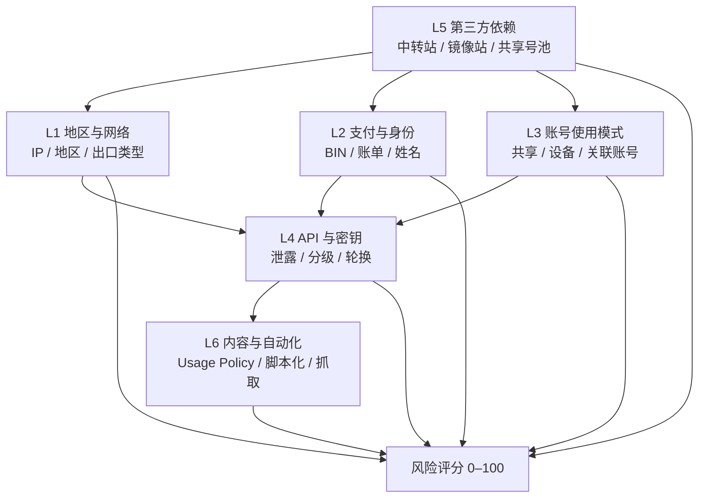

# claude-account-guard

[](LICENSE)
[](https://www.python.org/)
[](#安全性)

**中文** · [English](README.en.md) — 你正在读中文版。

**一个合规导向的 Claude Agent Skill：帮你在封禁发生前消除"可归因于自身配置"的风险，在疑似误封时做出可核验的申诉。**

> **它不是反封禁外挂。** 它不提供任何绕过服务地区限制、伪造支付/身份、账号买卖或对抗风控的方法。项目的全部价值建立在"遵守平台条款"这个前提上——因为违反条款本身，就是被封禁的首要原因。

---

## 目录

- [它解决什么问题](#它解决什么问题)
- [六层风险模型](#六层风险模型)
- [能做什么 / 不能做什么](#能做什么--不能做什么)
- [3 分钟快速开始](#3-分钟快速开始)
- [评分卡示例](#评分卡示例)
- [目录结构](#目录结构)
- [脚本说明](#脚本说明)
- [五步工作流](#五步工作流)
- [合规红线](#合规红线)
- [免责声明](#免责声明)
- [贡献指南](#贡献指南)

---

## 它解决什么问题

大量中文用户反馈 Claude 账号被限制或封禁，但说不清原因。复盘下来，高频原因往往不是"平台误判"，而是几件本来可以避免的事：

1. **用第三方中转 API 省钱** —— 上游账号池被封，下游连带；Key 在链路中被二次持有；出事后连申诉对象都不是自己。
2. **共享账号 / 多开小号** —— 同一设备、支付方式、出口 IP 上的账号天然关联，一封一串。
3. **Key 泄露** —— 提交到公开仓库、写进前端 bundle、打日志、截图发群，几分钟内就会被自动化工具采集并滥用。
4. **支付与网络矛盾** —— 卡 BIN 国家、账单地址、接入 IP、注册姓名彼此不一致，申诉时无法自证。

这四件事的共同点：**它们都可以在事前自查，也都可以用零成本的配置改动消除。** 本项目把它们整理成六层模型、25 项评分卡和三个只读脚本。

## 六层风险模型



- 只命中一层：通常可以用 A 级证据解释。
- 命中两层以上且互相独立：身份一致性整体存疑，申诉难度显著上升。
- 命中 L5（第三方依赖）或 L6（内容与自动化）：申诉空间很小，优先止损与迁移。

每层的「信号 → 平台如何观测 → 用户可自查项 → 合规处置动作 → 证据强度分级」见 [`references/ban-causes.md`](references/ban-causes.md)。

## 能做什么 / 不能做什么

| 能做 | 不能做（明确拒绝） |
| --- | --- |
| 扫描本地仓库与 git 历史里的密钥泄露 | 提供代理节点、IP 轮换、住宅代理、指纹浏览器配置 |
| 把风险量化成 0–100 分，排出优先处理的三项 | 伪造支付信息、虚拟卡刷号、争议退款套利 |
| 判断 `base_url` 是否指向第三方中转 | 批量注册、账号买卖/共享/转售、代充代付 |
| 给出支付、网络、身份一致性的自查清单 | 规避风控的调用节奏伪装、UA 伪造、反检测补丁 |
| 提供中英双语、事实导向的申诉模板 | 承诺解封、预测平台行为、评价风控算法 |
| 分享前脱敏（Key / Cookie / 邮箱 / 手机号 / 公网 IP / 用户名路径） | 声称"按本工具做就不会被封" |

## 3 分钟快速开始

```bash
git clone https://github.com/<your-org>/claude-account-guard.git
cd claude-account-guard

# 1) 只读体检你的项目（不联网、不上传）
python scripts/audit.py --path ~/projects/my-app --report-dir ~/projects/my-app

# 2) 扫一遍 git 历史里的密钥痕迹
python scripts/check_history.py --path ~/projects/my-app

# 3) 打分（先填 references/risk-scorecard.md 第 5 节的 JSON）
python scripts/audit.py --scorecard scorecard.json

# 4) 把报告/日志发给别人之前先脱敏
python scripts/redact.py -i report.md -o report.redacted.md
```

输出：终端摘要 + `report.md`（人读） + `report.json`（机器读）。每条发现都带 `severity`、为什么有风险、如何修复、官方文档链接。

**作为 Agent Skill 安装**（让 Claude Code / Claude.ai 自动触发）：

```bash
# 个人级
cp -r claude-account-guard ~/.claude/skills/claude-account-guard
# 或项目级
cp -r claude-account-guard .claude/skills/claude-account-guard
```

之后当你提到"账号会不会被封""能不能共用账号""base_url 填的是某中转""Key 好像泄露了""账号被封怎么申诉"时，Skill 会被自动加载。

## 评分卡示例

```console
$ python scripts/audit.py --scorecard scorecard.json

claude-account-guard · 风险评分卡

维度                      权重       命中项      得分
网络一致性                25     2.0/5    10.0
支付与身份一致性          20     1.0/4     5.0
账号使用模式              15     2.0/4     7.5
API Key 卫生              15     0.0/5     0.0
第三方依赖                15     0.0/4     0.0
内容与自动化              10     0.0/3     0.0

总分: 22.5/100  → 中风险 (21-45)
建议: 先处理得分最高的两个维度，尤其是支付身份与第三方依赖。

优先补齐:
  1. 网络一致性 的 N1（账号注册地/使用地在服务区域名单内，且接入 IP 属于该地区）
  2. 网络一致性 的 N2（接入 IP 国家与注册地、支付地一致）
  3. 支付与身份一致性 的 P1（卡 BIN 国家 = 账单地址国家 = 接入 IP 国家）

说明: 0=风险已消除 / 1=风险存在 / 0.5=不确定；评分是启发式自查，
      不与平台内部风险分相关。
```

分档：`0–20 低 / 21–45 中 / 46–70 高 / 71–100 极高`。权重：网络 25、支付身份 20、使用模式 15、Key 卫生 15、第三方依赖 15、内容与自动化 10。

## 目录结构

```
claude-account-guard/
├── SKILL.md                      # Agent Skill 入口（渐进式披露，< 500 行）
├── README.md                     # 中文主版本（本文件）
├── README.en.md                  # 英文版
├── LICENSE                       # MIT
├── CHANGELOG.md
├── .gitignore
├── pyproject.toml                # ruff / pytest 配置（显式固定规则集）
├── .github/workflows/ci.yml      # pytest + ruff，三平台
├── references/                   # 知识库（按需加载）
├── scripts/                      # 三个只读脚本（纯标准库）
├── assets/scorecard-template.md  # 可打印自查表
└── tests/                        # pytest + fixtures
```

### 知识库索引

| 文件 | 用途 | last-reviewed |
| --- | --- | --- |
| [`references/ban-causes.md`](references/ban-causes.md) | 封禁归因六层模型（核心知识库）：每层的信号/观测/自查/处置/证据强度 + 自查清单 | 2026-10 |
| [`references/risk-scorecard.md`](references/risk-scorecard.md) | 0–100 评分卡：权重、25 项判定标准、分档、手算示例、JSON 格式 | 2026-10 |
| [`references/network-and-region.md`](references/network-and-region.md) | 地区、网络、设备与时区一致性（含企业出口邻居风险） | 2026-10 |
| [`references/payment-and-identity.md`](references/payment-and-identity.md) | 支付、账单、身份一致性；争议退款的正确处置 | 2026-10 |
| [`references/api-key-hygiene.md`](references/api-key-hygiene.md) | Key 全生命周期：创建→存储→分级→轮换→泄露响应→历史清理 | 2026-10 |
| [`references/third-party-risk.md`](references/third-party-risk.md) | 中转/镜像/共享号池的结构性风险、评估清单与迁移步骤 | 2026-10 |
| [`references/incident-response.md`](references/incident-response.md) | 封禁后 72 小时行动手册：止损 → 证据固化 → 申诉 → 迁移 → 复盘 | 2026-10 |
| [`references/appeal-templates.md`](references/appeal-templates.md) | 中英双语申诉模板（疑似误封 / 共享账号 / 支付问题）+ 语气规则 | 2026-10 |
| [`references/myths.md`](references/myths.md) | 12 个常见"偏方"为什么有害，以及合规替代做法 | 2026-10 |

> 平台条款与支持地区会变。所有知识库条目标注了 `last-reviewed`，请以官方文档为准：
> [Consumer Terms](https://www.anthropic.com/legal/consumer-terms) ·
> [Commercial Terms](https://www.anthropic.com/legal/commercial-terms) ·
> [Usage Policy](https://www.anthropic.com/legal/aup) ·
> [Supported Countries](https://www.anthropic.com/supported-countries)

## 脚本说明

| 脚本 | 作用 | 关键约束 |
| --- | --- | --- |
| `scripts/audit.py` | 只读体检：环境变量/`.env`、疑似密钥、非官方 `base_url`、多账号痕迹、git 历史、时区一致性；支持 `--scorecard` 评分 | 不打印密钥原文；不修改被扫描文件；只写 `report.md`/`report.json` |
| `scripts/check_history.py` | 扫描 `git log -p` 的新增行与提交信息，找出历史里的密钥痕迹 | 命中结果一律脱敏输出；无 git 时优雅降级 |
| `scripts/redact.py` | 分享前脱敏：Key / Bearer / JWT / 私钥块 / Cookie / URL token / 邮箱 / 手机号 / 公网 IP / 用户名路径 | 幂等；`--check` 可用于 CI 门禁 |

三个脚本都是**纯 Python 标准库**，无第三方依赖、无网络请求、无遥测，Windows / macOS / Linux 可运行，Python 3.9+。

### 安全性

- **不联网**：脚本里没有任何 HTTP 客户端调用，`audit.py` 只在本地读文件与调用 `git`（只读子命令 `rev-list` / `log`）。
- **不上传**：没有埋点、没有遥测、没有"匿名统计"。
- **不打印密钥**：任何命中都会被替换成 `<redacted:类型:len=N>`，只保留类型与长度。
- **可审计**：三个脚本合计约 2.1k 行（含注释与文档字符串），`grep -rnE "import (requests|urllib\.request|socket|http\.client)" scripts/` 无任何输出。
- **本脚本不会上传任何数据。**

## 五步工作流

1. **定性**：事前自查 / 已出事 / 已确认违规 / 只是听说了一个偏方——四种情况回答完全不同。
2. **讲边界**：一句话说明"只降低可归因于自身的风险，不保证不被封，不给绕过手段"。
3. **六层自查**：按 `ban-causes.md` 的六个问题扫一遍，命中项进评分卡。
4. **技术体检**：`audit.py` + `check_history.py`，拿到 `critical` 先吊销，`high` 本周处理。
5. **处置或申诉**：分数 ≥ 46 按 `incident-response.md` 止损；已被封则用 `appeal-templates.md` 选模板，只写事实、附证据编号。

## 合规红线

本仓库**不会**、也**不接受**贡献以下内容：

- 绕过服务地区限制的节点选择、IP 轮换、住宅代理采购、指纹浏览器配置、设备伪装；
- 批量注册、账号买卖/共享/转售、代充代付；
- 伪造支付信息、虚拟卡刷号、争议退款套利；
- 规避风控识别的方法（节奏伪装、UA 伪造、反检测补丁）；
- 针对平台风控的逆向、探测或对抗手法。

遇到这类需求，标准回应是：

> 这种做法本身违反 Anthropic 使用条款，且是被封禁的首要原因之一——它不是降低风险，是在制造风险。

然后指向合规替代路径：官方支持地区的正常接入 → 云厂商通道（在其支持区域与合规框架内）→ Team/Enterprise 合规采购 → 本地可合法使用的替代模型（**合规可用性优先于模型偏好**）。

## 免责声明

- 本项目**非官方**，与 Anthropic 无隶属或背书关系。
- 本项目**不保证**账号不被限制或封禁，也不改变平台的服务区域政策与风控判断。
- 评分卡、六层模型、阈值与建议均为**启发式**，与平台内部实现无关。
- 本项目**不提供**任何规避、伪装或对抗手段，看到这类内容请提 issue 举报。
- 仓库内**不含任何真实密钥、真实用户数据或个人信息**；测试夹具中的凭据均为运行时随机生成的假串。
- 平台条款会变化，使用前请以官方文档为准。

## 贡献指南

欢迎贡献，尤其是：条款变更、官方文档链接失效、申诉模板措辞改进、跨平台兼容性问题。

```bash
python -m pytest -q          # 37 项测试
ruff check .                 # 规则集在 pyproject.toml 里固定
python scripts/audit.py --path . --no-history   # 自检
```

- 提交信息用 [Conventional Commits](https://www.conventionalcommits.org/)：`feat:` / `fix:` / `docs:` / `test:` / `chore:`。
- 新增知识条目必须带 `last-reviewed: YYYY-MM` 与官方链接。
- **不要提交真实密钥、真实账单、真实邮箱或截图。** 测试用 fixtures 一律使用运行时生成的假数据。
- PR 请说明：解决什么风险、依据哪条官方条款、如何自查。

## License

[MIT](LICENSE) © claude-account-guard contributors
